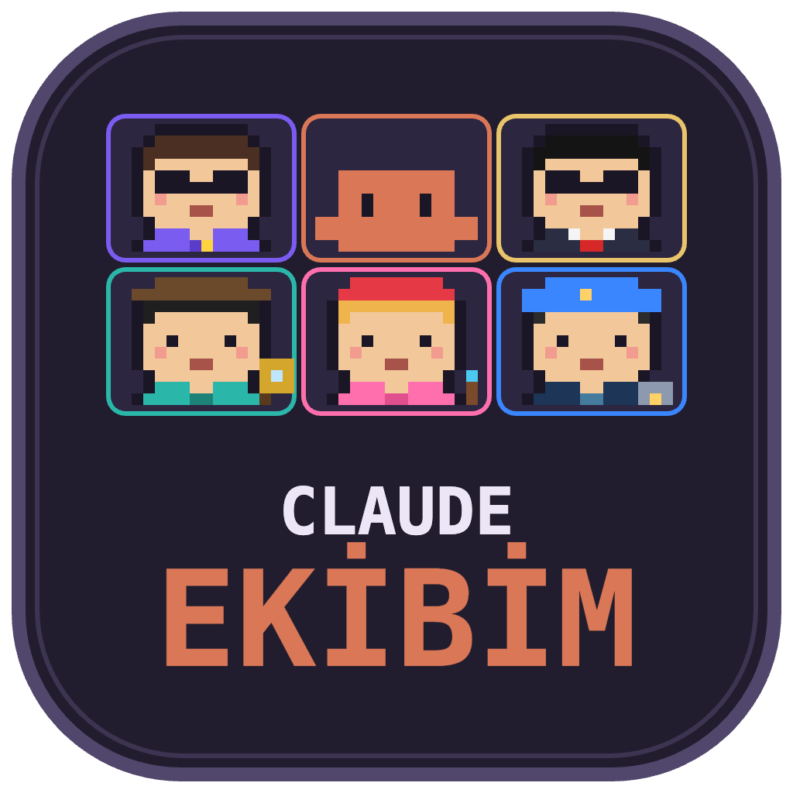
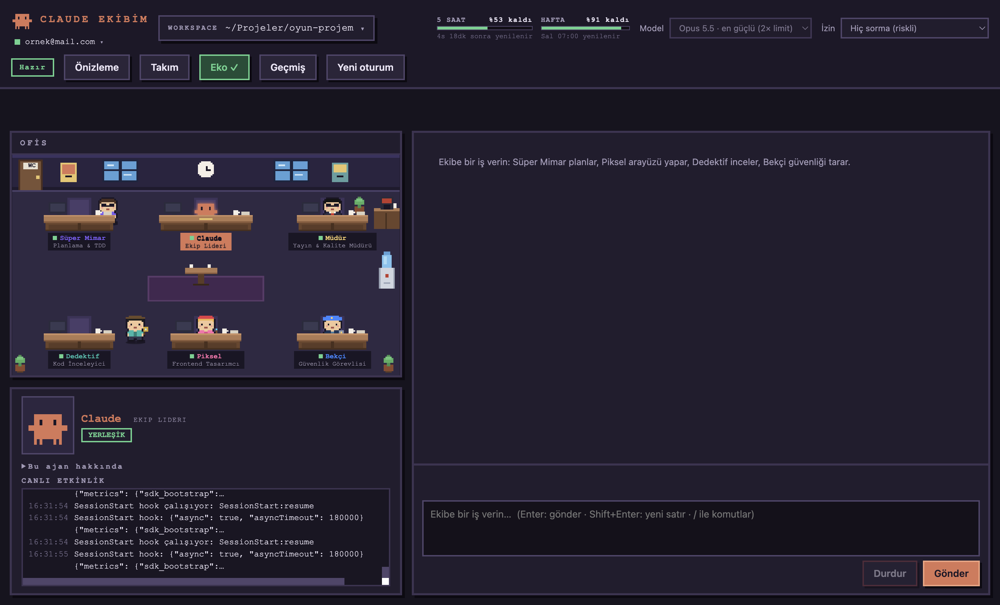
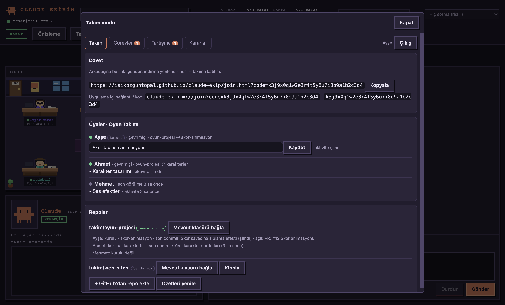
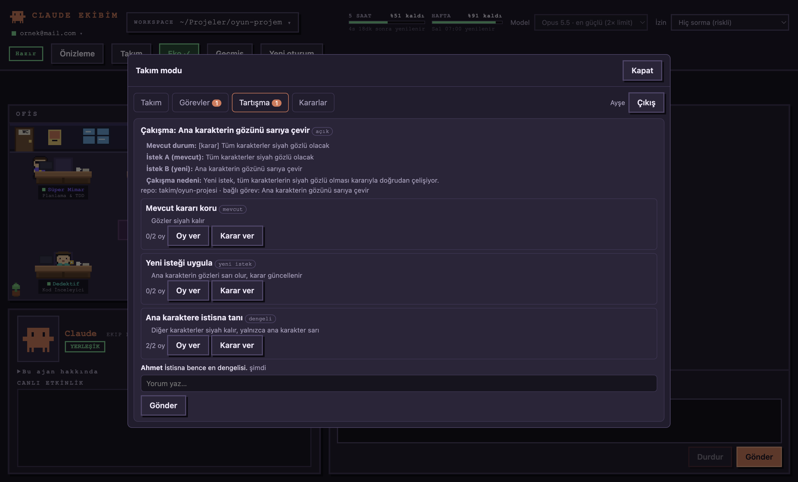
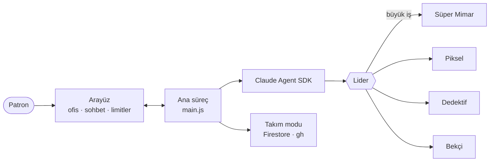

<div align="center">



# Claude Ekibim

**Claude Code'u pixel-art bir ofiste çalışan geliştirici ekibine dönüştüren masaüstü uygulaması.**
Bir lider, dört uzman ve bir müdür — her biri gerçek bir alt ajan ya da skill paketi.




</div>

---

## Ne yapar?

Sen **Patron**'sun; işi yazarsın. **Claude (lider)** küçük işi kendisi halleder, yalnızca büyük ve ayrılabilir işi ekibe böler. Ofisteki karakterler gerçekten ne yapıyorsa onu yaparlar: masalarında çalışır, işi bitince su alır, toplantı alanında buluşur — ve balonlarda yazdığın isteğin kısa özeti görünür.

| Üye | Rol | Nasıl çalışır |
|---|---|---|
| 🟠 **Claude** | Ekip lideri | Sohbeti alır, küçük işi kendi yapar, büyük işi böler |
| 🟣 **Süper Mimar** | Planlama & TDD | Gerçek alt ajan (Sonnet, salt okunur araçlar) — `superpowers` |
| 🩷 **Piksel** | Frontend tasarımcı | Gerçek alt ajan (Sonnet, düzenleme yetkili) — `frontend-design` |
| 🟢 **Dedektif** | Kod inceleyici | Gerçek alt ajan (Haiku) — `code-review` |
| 🔵 **Bekçi** | Güvenlik görevlisi | Gerçek alt ajan (Haiku, salt okunur) — `security-guidance` |
| 🟡 **Müdür** | Yayın & kalite | Skill paketi — `gstack` |

> Alt ajanlar ucuz modellerde ve dar araç setiyle çalışır; böylece büyük iş bölününce limitin boşuna erimez.

## Özellikler

- 🏢 **Animasyonlu ofis** — rütbeye göre masalar, sebil, WC, toplantı alanı; karakterler dolaşır, konuşur, göreve bağlı balonlar çıkarır.
- 🤖 **Gerçek alt ajanlar** — lider yalnızca gerektiğinde `supermimar`, `piksel`, `dedektif`, `bekci` ajanlarına devreder; arayüz her satırı doğru üyeye atfeder.
- 🌱 **Eko mod** — küçük sorular için Haiku, kısa talimat, plugin/alt ajan yok. Aynı soruda ~3× daha az token (31 bin → 9,7 bin).
- 📊 **Limit ve tahmin** — 5 saatlik ve haftalık limit çubukları; iş yazarken tahmini token ve limit etkisi (geçmiş işlerden öğrenir).
- 🕘 **Oturum geçmişi** — "Yeni oturum" sohbeti silmez, arşivler; istediğin oturumu açıp kaldığın yerden sürdürürsün.
- 🖥️ **Canlı önizleme** — yanda Tarayıcı, **iOS Simulator** ve Resimler sekmeleri; ajan ekran görüntüsü alıp, dokunup, yazıp uygulamayı gerçekten dener.
- 🧰 **Komut düğmeleri** — sık kullandığın terminal komutları tek tıkla (ör. `open -a Xcode`).
- 🖼️ **Sürükle-bırak ekran resmi** — "ekran resmi N" adıyla sohbete eklenir.
- 💬 **Kalıcı sohbet** — uygulama kapanıp açılınca kaldığın yerden devam.

## Takım modu <sub>(ilk sürüm)</sub>

Üç kişilik, herkesin **kendi Claude hesabıyla** çalıştığı bir ekip için. Hesap, kimlik bilgisi veya oturum paylaşılmaz; sohbetler ve promptlar yalnızca kendi bilgisayarında kalır. Sunucuya sadece durum, repo özeti, görev ve karar bilgisi (metadata) gider.

<div align="center">


</div>

- **Davet linki** — arkadaşın uygulamayı indirir ve takıma katılır.
- **Üyeler ve durum** — çevrimiçi/çevrimdışı, şu an üzerinde çalıştığı konu, aktif repo ve branch, son aktivite.
- **Repolar** — GitHub (`gh`) üzerinden branch, açık PR ve son commit; kurulu olmayan repo için "bağla / klonla".
- **Görev isteği** — birine görev bırakırsın; **alıcı onaylamadan hiçbir şey çalışmaz**. Onaylanınca iş alıcının makinesinde, kendi Claude hesabıyla yürür; sonuç (özet, dosyalar, PR) sana döner.
- **Çakışma tespiti** — yeni istek, mevcut kararlar/görevler/notlarla karşılaştırılır:
  - *çakışma yok* → kuyruğa alınır
  - *küçük çakışma* → "Yoksay" (nedeniyle kayda geçer)
  - *anlamlı çakışma* → **Tartışma** sekmesinde konu açılır: iki taraf, mevcut durum, neden ve 2–3 seçenek (dengeli alternatif dahil). Oy/yorum → karar kaydı, görev ve repoya bağlı.

> Örnek: biri "tüm karakterler siyah gözlü olsun" demiş; başkası "karakterin gözünü sarıya çevir" diyor → sistem çelişkiyi yakalar, otomatik uygulamak yerine tartışma açar.

Sunucu: **Firebase** (ücretsiz Spark planı; Authentication + Firestore). Kurulum için bkz. [`docs/takim-modu.md`](docs/takim-modu.md).

## Hızlı başlangıç

```bash
git clone https://github.com/isikozguntopal/claude-ekip.git
cd claude-ekip
npm install
npm start
```

İlk açılışta:
1. Sol üstteki hesap menüsünden bu uygulamanın Claude hesabıyla giriş yap (ana Claude hesabından bağımsız, `~/.claude-ekip` profili kullanılır).
2. **Workspace** olarak üzerinde çalışacağın proje klasörünü seç.
3. Ekip üyelerinin plugin'lerini tek tıkla kur ve **Yeni oturum** başlat.

Gereksinimler: Node.js 20+, Claude Code (masaüstü uygulamasıyla gelen ikili dosya ya da `claude` komutu). macOS'ta Dock/menü adı için `npm start` markalı bir Electron kopyası hazırlar. Takım modu için ayrıca [GitHub CLI](https://cli.github.com) (`gh auth login`).

## Nasıl çalışır?



```
main.js         Electron ana süreç: ayarlar, oturum, alt ajanlar (TEAM_AGENTS), eko mod, arşiv, tahmin
team.js         Üyeler, plugin eşleşmeleri, sistem talimatları
team-mode.js    Takım modu: giriş, presence, repo özeti, görev kuyruğu, tartışma/karar
conflict.js     Çakışma tespiti (saf mantık, Haiku ile karşılaştırma)
preload.js      Ana süreç ↔ arayüz köprüsü
renderer/       Arayüz: ofis (canvas), sohbet, önizleme, komutlar, takım paneli
firebase/       Firestore güvenlik kuralları
site/join.html  Davet sayfası (GitHub Pages ile yayınlanabilir)
scripts/        Markalı başlatıcı, ikon üretimi, testler
```

## Test

```bash
node scripts/conflict-test.js      # çakışma tespitini gerçek Haiku çağrısıyla dener
node scripts/team-mock-test.js     # takım modunu sahte Firebase ile uçtan uca dener
```

## Gizlilik

- Sohbet, prompt ve yanıtlar **sunucuya yazılmaz**.
- Çakışma kontrolü kendi bilgisayarında çalışır: paylaşılan kayıtlar indirilir, karşılaştırma yerel modelle yapılır.
- Kimse başkasının Claude hesabından prompt çalıştıramaz.

## Yol haritası

- [ ] Takım modunu gerçek Firebase projesiyle uçtan uca doğrulama
- [ ] GitHub/Google ile giriş
- [ ] Hazır macOS/Windows kurulum paketleri ve imzalı sürümler
- [ ] Yerel promptlar için isteğe bağlı sürekli çakışma kontrolü
- [ ] Toplantı transkriptlerini otomatik içe aktarma

---

<div align="center"><sub>Claude Agent SDK ile yapıldı · pixel-art ofis, gerçek ajanlar</sub></div>
